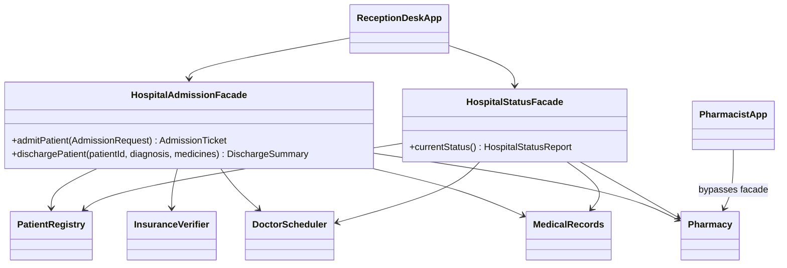

# Hospital Admission — Facade Pattern

Assignment #4, Software Design Patterns.

A hospital reception desk has to talk to five independent systems to admit and discharge one patient: the patient registry, the insurance company, the doctors' schedule, the medical records archive and the pharmacy. Each step has its own rules, the steps must run in the right order, and if one of them fails the earlier ones must be undone.

`HospitalAdmissionFacade` hides all of that behind two calls:

```java
AdmissionTicket ticket = reception.admitPatient(request);
DischargeSummary summary = reception.dischargePatient(patientId, diagnosis, medicines);
```

## Structure

```
src/hospital/
├── subsystem/                      complex subsystem (knows nothing about facades)
│   ├── PatientRegistry             registers patients, validates national ID, issues hospital IDs
│   ├── InsuranceVerifier           checks policy exists, belongs to the patient, not expired; returns coverage %
│   ├── DoctorScheduler             books the least busy doctor of a specialty, respects daily capacity
│   ├── MedicalRecords              one open record per patient; diagnosis required before closing
│   ├── Pharmacy                    all-or-nothing dispensing, stock and allergy checks
│   └── (data types + SubsystemException hierarchy)
├── facade/
│   ├── HospitalAdmissionFacade     MAIN facade: admitPatient(), dischargePatient()
│   ├── HospitalStatusFacade        ADDITIONAL facade: read-only overview for the head doctor
│   └── AdmissionRequest, AdmissionTicket, DischargeSummary, HospitalStatusReport, exceptions
├── client/
│   ├── ReceptionDeskApp            client: uses ONLY the facades
│   └── PharmacistApp               "advanced" client: uses Pharmacy directly, bypassing the facade
└── Hospital                        composition root: creates subsystems, seeds demo data, wires facades
```



### What the facade coordinates

**admitPatient**
1. Find the patient by national ID or register a new one
2. Verify insurance (skipped for self-paying patients)
3. Open a medical record
4. Book a doctor of the requested specialty

Each successful step pushes its undo action onto a stack. If a later step fails, the stack is unwound in reverse order (cancel booking → delete record → unregister patient), and the client receives one `AdmissionFailedException`.

**dischargePatient**
1. Write the diagnosis into the record
2. Dispense medicines (checks stock and allergies; changes nothing if any check fails)
3. Close the record
4. Free the doctor's slot
5. Calculate the bill: consultation fee + medicines, split between insurer and patient

If the pharmacy refuses (e.g. allergy), the patient stays admitted and discharge can be retried with another prescription.

## How to run

Requires JDK 17+.

```bash
javac -d out $(find src -name "*.java")
java -cp out hospital.client.ReceptionDeskApp   # main demo, facade only
java -cp out hospital.client.PharmacistApp      # subsystem used directly
```

Or open the folder in IntelliJ IDEA, mark `src` as Sources Root and run `ReceptionDeskApp`.

The demo covers: a successful admission and discharge with insurance; an expired policy (admission refused, registration rolled back); an allergy conflict on discharge followed by a valid prescription; a fully booked neurologist (two steps rolled back); and a status report from the second facade.

## Facade rules followed

- **Client uses only the facade.** `ReceptionDeskApp` imports nothing from `hospital.subsystem`. The request and result types (`AdmissionRequest`, `AdmissionTicket`, `DischargeSummary`) use plain Java types; the specialist is passed as a string and converted to the subsystem enum inside the facade.
- **Subsystem does not know about the facade.** No class in `hospital.subsystem` imports or references `hospital.facade`. Dependencies go one way only.
- **Subsystem is still usable directly.** `PharmacistApp` works with `Pharmacy` alone, without any facade.
- **The facade coordinates, it does not reimplement.** Insurance rules, doctor selection, allergy checks and record rules all live in the subsystem classes. The facade only decides the order of calls, collects results and handles failures.
- **Second facade for an unrelated concern.** Reporting (`HospitalStatusFacade`) is separate from admissions, so the reception API stays small.

## Clean Code principles

1. **Meaningful names.** The facade API reads like the real-world process: `admitPatient`, `dischargePatient`, `currentStatus`. Subsystem methods say exactly what they do: `verifyCoverage`, `book`, `release`, `dispense`, `medicinesBelow`. Constants replace magic numbers: `LOW_STOCK_THRESHOLD`, `FULL_COVERAGE_PERCENT`, `NATIONAL_ID_LENGTH`.

2. **Single Responsibility Principle.** Each subsystem class owns one area: `InsuranceVerifier` only answers "is this policy valid and how much does it cover", `Pharmacy` only manages medicines. The facade has one job, coordination. The billing arithmetic is a single private method, `buildSummary`. Object creation and demo data live in a separate class, `Hospital`, so neither the facade nor the client deal with wiring.

3. **No leaking of subsystem details.** The facade's public methods accept and return only facade-owned types and plain Java types. Subsystem exceptions are wrapped into `AdmissionFailedException` / `DischargeFailedException`, so the client doesn't depend on the internals. `ActiveAdmission` is a private record inside the facade.

4. **Small, focused classes and methods.** Every class has a clear purpose and fits on one screen. Long operations are split into private helpers with descriptive names: `findOrRegisterPatient`, `checkInsurance`, `parseSpecialty`, `buildSummary`, `rollBack`.

5. **Proper error handling for coordination failures.**
   - Subsystems throw specific exceptions (`InsuranceRejectedException`, `NoDoctorAvailableException`, `AllergyConflictException`, …) under a common base, `SubsystemException`.
   - `admitPatient` uses compensating actions (an undo stack), so a failed admission never leaves half-created data behind.
   - `Pharmacy.dispense` validates everything before changing stock (all-or-nothing).
   - `dischargePatient` runs the step that can fail (dispensing) before the irreversible ones (closing the record, freeing the doctor).

6. **Encapsulation and immutability.** Data carriers are records. `Patient` copies its allergy set and `MedicalRecord.notes()` returns a copy. `MedicalRecord` mutators are package-private, so only `MedicalRecords` can change a record. `DoctorScheduler.Doctor` is a private nested class.

7. **Dependency Inversion / constructor injection.** Facades receive their subsystems through the constructor instead of creating them. This makes the dependencies explicit and lets both facades share the same subsystem instances.

8. **Fail fast with guard clauses.** Invalid input (empty name, wrong national ID format, unknown specialist, empty diagnosis) is rejected immediately with a clear message, before any state changes.
